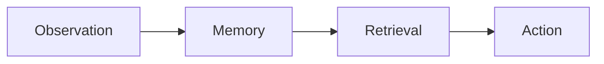

## 如何发布
复制此文件，修改标题、日期、摘要、标签及正文，检查所有内容后把 `draft: true` 改为 `draft: false`。草稿不会生成公开路由，也不会进入搜索和 RSS。

## Math
Memory retrieval can be written as $p(m \mid q)$.

## Code
```python
def retrieve(query, memory):
    return memory.search(query)
```

## Diagram


## Images
图片放入 `public/assets/blog/`，引用方式：``。
